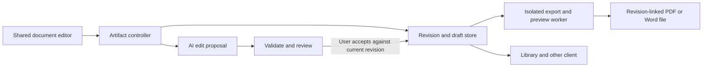

# FRIDAY document and artifact editing: research and improvement plan

## Implementation update — 2026-11-05

FRIDAY 0.30 implements the bounded artifact workflows across stages 0–5: revisioned documents, a bundled offline ProseMirror editor, reviewed AI changes, comments, recovery, imports/exports, file previews, separate interactive-app state, template slides and bounded spreadsheets. The implementation uses `artifact_formats.py` and an isolated `artifact_worker.py` for conversion. See [the shipped feature guide and limits](workspace/ARTIFACTS.md).

The original research below is retained as the design record. Code and automated checks do not satisfy every acceptance gate: physical Android/browser input, accessibility and simultaneous two-device interaction remain unverified. Chat links open a resizable companion workspace on wide screens and a full-screen view on phones. Office import is intentionally lossy with retained originals and warnings. Public hosting, real-time multi-user collaboration, full Office fidelity and freeform slide design remain deferred as described below.

## Original assessment

Assessed 2026-11-04 against FRIDAY 0.29.0 (`4b9163b`) and current official product documentation. This is a proposed implementation plan, based on source inspection and documentation research. The comparator interfaces were not exercised hands-on, and no application changes or deployment were made during this assessment.

## Recommendation

Build a persistent artifact workspace around FRIDAY's existing file generation, Canvas and interactive rendering. The first release should let a person create a document, edit it directly, ask for a change to a selected passage, review that change, reopen the same document on either client, restore an earlier revision and export a checked PDF or Word file.

Treat this as one complete workflow. A formatting toolbar alone would leave the most consequential problems unresolved: temporary drafts, disconnected output files, edits without stable targets and no revision recovery.

Start with documents and existing generated files. Extend the same identity, history and review mechanisms to interactive artifacts next, then to presentations and spreadsheet editing. Keep public hosting and multi-user collaboration as later projects with their own access controls.

## What ChatGPT and Claude demonstrate

### ChatGPT: distinguish editable pages from generated files

ChatGPT's documented file workflow provides desktop previews for documents, presentations, spreadsheets and PDFs, with focused revision requests through annotations. HTML can have source and interactive views; standalone LaTeX has source editing and PDF compilation. The web, CLI and IDE have different preview capabilities. This does not establish that every file preview is a full native editor. [Work with files](https://learn.chatgpt.com/docs/artifacts-viewer).

Space Pages are a separate editing surface: structured blocks, direct formatting, selection-based change requests, comments, rearrangement, source references and embedded visualizations. Generated content can be reviewed and undone. [Work with pages](https://learn.chatgpt.com/docs/space/pages).

**Lesson for FRIDAY:** offer a clear distinction between editing a native document and reviewing an imported/generated file. Both should remain connected to their sources and revision history.

### Claude: artifact types share a common working lifecycle

Claude Docs provides persistent rich text, autosave, direct and conversational edits, anchored comments, contributor attribution and simultaneous editing. Its documentation also describes version history, Word/PDF/Markdown export and limitations: charts require explicit refresh, mobile sharing settings are restricted and comment-only access is unavailable. [Claude Docs](https://support.claude.com/en/articles/16923645-get-started-with-claude-docs).

Claude's artifact library includes specialized document, slide and design experiences. Slides support editing individual objects and presenting; the export formats depend on the artifact type. [Artifact overview](https://support.claude.com/en/articles/17153992-what-are-artifacts-and-how-do-i-use-them). Design adds canvas editing, reusable design systems and engineering handoff. [Claude Design](https://support.claude.com/en/articles/14604416-get-started-with-claude-design).

Custom artifacts can have persistent application data, connected tools and AI actions. Their exported HTML does not retain the hosted storage, AI or connector services. [Custom artifacts](https://academy.claude.com/tutorials/build-custom-artifacts-with-claude).

**Lesson for FRIDAY:** share artifact identity, navigation, revisions and permissions, while giving each content type an appropriate editor. Keep application data separate from generated application code.

These are documented capabilities across different surfaces and availability conditions, not a claim that every account or client exposes the same controls. Neither vendor's documentation proves its private implementation architecture, editing algorithms or rendering fidelity.

## FRIDAY's actual starting point

| Area | Observed implementation | Implication |
| --- | --- | --- |
| Canvas content | `CanvasDoc` contains only `title` and `body`. Opening an answer takes at most 20,000 characters; edits take at most 50,000. Markdown text is retained, while interactive replies become a Markdown fallback. [ChatActions.kt](../core/src/commonMain/kotlin/com/localfirst/assistant/client/ChatActions.kt), [ReplyText.kt](../core/src/commonMain/kotlin/com/localfirst/assistant/presentation/ReplyText.kt) | No artifact ID, source binding, structured selection, revision or explicit truncation feedback. |
| Canvas UI | Shared `CanvasSheet` has title/body text fields and save/download/copy controls. [ChatCards.kt](../shared-ui/src/commonMain/kotlin/com/localfirst/assistant/ui/ChatCards.kt) | A useful starting point, but no rich formatting, document outline, change review, comments or history UI. |
| Save lifecycle | Browser/shared `WorkspaceController` and Android `ChatViewModel` separately save a Markdown file. Closing clears the draft. Save completion clears Canvas without comparing it to edits made while the request was pending. [WorkspaceController.kt](../core/src/commonMain/kotlin/com/localfirst/assistant/client/WorkspaceController.kt), [ChatViewModel.kt](../app/src/main/java/com/localfirst/assistant/ui/ChatViewModel.kt) | A possible save-in-flight data-loss case needs a regression test. Both orchestration paths must adopt the new contract. |
| File identity | `put_file` creates a fresh UUID. File records have name, MIME, size and creation time, without revision ancestry. [workspace.py](workspace/workspace.py) | Saving another draft creates another file, rather than updating a named artifact. Existing `assistant://artifact/<id>` links identify file blobs. |
| Library | Filename search, type filters, paging, download/open, attachment reuse and delete already exist. [FeatureScreens.kt](../shared-ui/src/commonMain/kotlin/com/localfirst/assistant/ui/workspace/FeatureScreens.kt) | Extend Library with artifact entries and an editor destination; retain ordinary file behavior. |
| Synchronization | Workspace records use revision checks and HTTP 409 conflicts; a change feed already exists. The `items` table stores current records, not historical document versions. [workspace.py](workspace/workspace.py), [WorkspaceRepository.kt](../core/src/commonMain/kotlin/com/localfirst/assistant/client/WorkspaceRepository.kt), [ChangeFeed.kt](../core/src/commonMain/kotlin/com/localfirst/assistant/client/ChangeFeed.kt) | Reuse the conflict policy and feed infrastructure. Add durable artifact history rather than mistaking a revision counter for recoverable versions. |
| File generation | Both chat paths expose sandboxed Python and file creation. Current libraries include `python-docx`, `reportlab`, `openpyxl`, pandas and matplotlib. [WorkspaceTools.kt](../core/src/androidMain/kotlin/com/localfirst/assistant/tools/WorkspaceTools.kt), [chat_tools.py](workspace/chat_tools.py) | Generation exists. Add artifact registration, deterministic export adapters, previews and targeted editing tools. |
| Imports | PDF and DOCX extraction supply model context; DOCX extraction flattens paragraphs/tables, and scanned PDFs send at most four page images. [document.py](workspace/document.py) | This is not a lossless rich-document importer. Preserve the original file and report conversion limits. |
| Interactive answers | Shared GenUI components and script runtime exist. AppBlocks use an offline Android WebView or an opaque-origin browser iframe. Android state persists by conversation; browser state is session/tab based. [shared-ui README](../shared-ui/README.md), [GenUiSessions.kt](../app/src/main/java/com/localfirst/assistant/ui/genui/GenUiSessions.kt) | Interactive artifacts are partially present. The missing pieces include durable independent identity, cross-client state, revision navigation and controlled refinement. |

The existing file quota is 500 MB, with a normal 25 MB per-file cap. The Python worker has a 35-second wall-clock limit, one concurrent analysis and restricted resources. Document history and rendering must account for these limits instead of increasing them implicitly.

Read-only runtime inspection found `bwrap`, `soffice`, `pdftoppm`, `python-docx`, `reportlab`, `openpyxl` and `pypdfium2`. `python-pptx` was absent. Command/module presence does not verify isolated Office conversion, rendering quality or performance.

## The target user experience

Example: **“Turn these notes into a project proposal.”**

1. FRIDAY creates a named document artifact linked to the chat and its source files. A card opens that artifact, rather than another unrelated download.
2. On a wide screen, chat and document sit beside each other. On a phone, the document opens full screen with a simple return to chat. The same artifact and editing commands work on both.
3. The user edits text directly, adds headings, a table or an image, and sees whether the current draft is saved, pending sync or conflicted.
4. Selecting a paragraph offers **Ask FRIDAY**, **Comment** and formatting. “Make this shorter; preserve the dates” produces a proposed edit to that selection.
5. The user reviews a readable before/after diff and accepts or rejects it. Accepting is one undoable transaction. A concurrent manual change is preserved and makes an outdated proposal require review again.
6. The document can be closed, reopened from Library, edited from another conversation and restored to an earlier revision. Restoring creates a new revision and preserves later history.
7. Export offers Markdown, PDF and Word. The result records its source revision; the preview shows the actual exported output, including any conversion warnings.

New documents may be created directly from the user's request. Edits to existing work default to proposals, so “improve this section” cannot silently replace unrelated content. Batch edits can be accepted together when they form one coherent change.

## Architecture: extend the existing modules

### 1. Stable artifacts, immutable revisions and explicit derived files

Add an artifact service to `desktop/workspace` using the existing private SQLite database and file storage. Keep three concepts separate:

- **Artifact:** ID, kind, title, optional project/chat/source references, current revision and deletion state.
- **Revision:** immutable content or file manifest, parent revision, author (`user` or `assistant`), timestamp, summary and content hash. First save and every accepted AI change receive durable checkpoints; routine autosaves can be coalesced.
- **Derived output:** a PDF, DOCX, thumbnail or other export tied to an exact revision, export options and renderer version. An export is not the authoritative editable document.

Use a small versioned document schema with stable block IDs: paragraphs, headings, lists, quotes, code, images and simple tables, plus inline formatting and links. Markdown is an interchange format; the editor's private object model and arbitrary HTML should not become the persistence contract. Introduce additional block types only when a shipped feature needs them.

Keep existing file IDs and URLs working. Reference immutable file blobs from artifacts and account for them under the existing quota. Deletion must preserve referenced assets or explicitly explain the consequences. Backups must include artifact manifests, revision history and their referenced assets. Preserve imported originals. Add recoverable trash and a defined retention policy rather than immediate irreversible removal.

For change notification, publish lightweight artifact metadata into the existing workspace feed in the same transaction as an artifact commit. Reserve those metadata keys from generic item writes; artifact routes remain authoritative. Fetch document bodies and history on demand. Do not put every historical snapshot into the general chat sync feed.

### 2. One editing contract for Android and browser

Place document models, validation, selection mapping, edit commands, draft state and API orchestration in `core/commonMain`. Put the workspace frame, toolbar, outline, comments, diff/history screens and responsive layouts in `shared-ui/commonMain`. Android and browser supply file, persistence, selection/IME and preview adapters where necessary.

Both `ChatViewModel`/the native conversation engine and `WorkspaceController`/PC jobs must use the shared artifact controller. Reusing the shared screen alone is insufficient.

Use existing expected-revision conflict behavior. A device saves against the revision it read. On conflict, keep the local draft, offer comparison/retry or save a copy, and never overwrite silently. Local undo and server revision history serve different purposes and both are needed. Server acknowledgements must identify the draft they saved; an older acknowledgement cannot clear newer edits.

Android can retain normal drafts in app-private storage for offline recovery. Browser credentials remain in tab memory. Start with server autosave plus explicit unsaved-state handling in the browser; durable browser caching needs an explicit storage/lock policy, not an incidental `localStorage` write. Incognito artifacts stay ephemeral and require an explicit action to export or persist.

### 3. Constrained AI edits

Add shared tool contracts for artifact creation, bounded reading, edit proposals and exports. An apply operation should require a user-approved proposal; it must not be an unrestricted model tool that can approve its own output.

A proposal identifies the artifact, base revision, target block/selection, expected source content and replacement operations. A selection includes block IDs, an agreed offset encoding and selected-text hash. Kotlin/JS UTF-16 offsets need explicit conversion on Python; emoji and combining characters belong in the test fixtures.

Validate schema, size, target existence, base revision, expected text and permitted operation scope before showing a proposal and again before accepting it. No fuzzy replacement when there are repeated passages or a changed revision. Retain the proposal on a conflict so the user can inspect it.

Send the local model the document outline, selected blocks and relevant neighboring/source material. Fetch more only when needed. Avoid whole-document regeneration for a paragraph edit. Preserve links and citations as structured content; label unsupported factual additions rather than silently replacing sourced claims.

Retries need idempotency keys: lost acknowledgements, job restarts or a double tap must not duplicate artifacts or apply an edit twice. Streaming model text is a preview of a proposal, not partial committed document content. Cancellation leaves the current document intact.

### 4. Preview and export workers

Begin with Markdown/text, images and PDF previews; add generated DOCX previews through conversion. Use a bounded rendering worker with no network, host credentials, macros or external resource loading. Give Office conversion a disposable user profile. Its resource profile may differ from the current short Python-analysis job, but it must remain isolated and cancellable. LibreOffice documents headless conversion and separate profile parameters; this still needs a real sandbox feasibility test. [LibreOffice command-line parameters](https://help.libreoffice.org/latest/en-US/text/shared/guide/start_parameters.html).

Reuse `python-docx`, `reportlab` and `pypdfium2` where appropriate. Render a DOCX through the selected converter before claiming its layout was checked; a separately generated PDF does not prove the Word file looks the same. Record missing fonts, unsupported elements and stale previews. Preserve the last successful preview with its revision label if rendering fails.

Render page images on demand, cache by content hash/options/renderer version and prune derived previews before user-authored content. Original PDFs are preview/annotation sources initially, not editable word-processing documents. Importing DOCX into FRIDAY's document schema must show a conversion summary and retain the original.

## Editor dependency decision

FRIDAY currently uses Kotlin 2.0.21, Compose Multiplatform 1.7.3 and JavaScript IR. The inspected Compose Rich Editor upstream targets JS and Android, but its current build uses substantially newer Kotlin/Compose versions. A “supports multiplatform” badge does not establish compatibility with this checkout. [Editor targets](https://raw.githubusercontent.com/MohamedRejeb/compose-rich-editor/main/richeditor-compose/build.gradle.kts), [upstream versions](https://raw.githubusercontent.com/MohamedRejeb/compose-rich-editor/main/gradle/libs.versions.toml).

**Preferred path:** test a pinned compatible Compose Rich Editor version behind the shared editor contract. Verify formatting, selection, undo, IME composition, clipboard handling, accessibility and supported document round trips on both targets. Keep complex tables as explicit structured blocks if the inline editor cannot represent them safely. Do not persist the library's internal state directly. [Compose Rich Editor](https://github.com/MohamedRejeb/compose-rich-editor).

**Fallback:** one bundled ProseMirror-based editor hosted through Android WebView and browser DOM adapters, with the surrounding UI, validation and business logic still shared. This adds a JS build and bridge maintenance burden. The first-party repository documents a move from GitHub to its current host; evaluate current packages, not the archived mirror as if it were the active upstream. [ProseMirror](https://github.com/ProseMirror/prosemirror).

Choose one implementation after a bounded prototype. Do not ship two competing editors, hand-build a general rich-text engine, or couple this feature to an unplanned framework-wide upgrade. Failure of the compatibility prototype is a concrete decision point, not a reason to claim a text-area upgrade is rich editing.

## Delivery sequence and acceptance gates

| Stage | Deliverable | Acceptance gate | Relative size |
| --- | --- | --- | --- |
| **0 — Resolve feasibility** | Shared-editor prototype; isolated DOCX-to-PDF rendering probe; fixture corpus and capability inventory. | Android and JS can edit/round-trip the chosen subset with correct selection/undo. Converter works inside the intended service sandbox. Pin dependencies and record unsupported features. | Small, bounded investigation |
| **1 — Preserve work** | Artifact identity, revision store, draft recovery, conflict handling, Library reopen and history/restore. Remove silent Canvas truncation; preserve edits made during save. | Restart, offline reconnect, two-device conflict and duplicate-request tests lose no content. Existing files and chat links remain valid. | Medium |
| **2 — Edit documents with FRIDAY** | Rich document surface, outline, formatting, simple tables/images, selected-text AI requests, comments and proposal review. | “Shorten this paragraph” changes only the accepted selection. Manual edits during generation survive. Both clients use the same validation and tool contracts. Keyboard/IME/accessibility interactions pass. | Large |
| **3 — Deliver checked files** | PDF/image/file viewer, import-with-warnings, Markdown/DOCX/PDF exports, revision-linked previews and export checks. | Real fixture exports are opened/rendered and inspected; links, images, tables, pagination and fonts are checked. Failed or stale previews are never presented as current. | Medium to large |
| **4 — Promote interactive answers** | Save existing GenUI/AppBlocks as named artifacts; source/preview switching, revisions, diagnostics and cross-client persistent state. | Reopen a tracker on another device; update its UI without losing entries; restore code without silently reverting data; blocked network/token access stays blocked. | Medium to large |
| **5 — Add specialized editors** | Template-based slide editing/presentation/export, then bounded spreadsheet inspection and edit proposals; reusable document/design templates. | Slide and sheet fixtures validate exported layout, formula preservation, data types and unsupported-feature warnings. | Large; split into separate releases |

Stages 1–3 form the first complete document-editing release. Stage 0 determines dependency and rendering feasibility before committing to an editor or delivery estimate. The size labels describe engineering scope, not promised calendar dates.

The smallest meaningful implementation slice is **one persistent document → direct edit → selected AI proposal → accept/undo → reopen on the other client → PDF/DOCX export**. Avoid shipping a broad set of empty artifact-type tabs before that works.

### Interactive artifact boundaries

Promote the existing AppBlock/GenUI hosts rather than enabling arbitrary HTML on the gateway origin. Keep the iframe opaque, deny network access by default, validate bridge messages and expose no bearer tokens. A trusted editor host and untrusted generated-app host must remain separate surfaces.

Store application code revisions separately from application data revisions. A UI change cannot erase tracker entries; incompatible state-schema changes require an explicit migration or reset. Every bridge request is bound to its artifact and session, and imported content cannot select another artifact's state. Avoid executing saved/imported scripts just to list or thumbnail them.

Initially support read-only previews and the existing user-confirmed “add to composer” actions. Later connector/AI actions must go through narrow host-mediated capabilities and current approvals. Static HTML export should identify which persistent or connected features will not work outside FRIDAY.

### Features deliberately sequenced later

- **Slides:** begin with structured, template-based slides and direct text/reorder/theme changes. Full freeform drawing and animation editing are separate investments. Add `python-pptx` only when this phase needs it.
- **Spreadsheets:** initially show sheets, ranges, formulas and proposed bounded changes. `openpyxl` presence does not provide spreadsheet recalculation; a calculation engine and formula-fidelity tests are separate requirements.
- **Templates:** store reviewed typography, spacing, colors and document structures as local reusable templates. Keep source content separate from style so restyling does not rewrite facts.
- **LaTeX:** add source/PDF compilation if scientific-document demand justifies the toolchain and sandbox work.
- **Sharing:** private links within the existing authenticated workspace can precede public publishing. Multi-user edits require distinct identities and per-artifact access; the current single-owner bearer token is not an invitation system. Real-time collaborative merging should follow actual multi-user demand, not precede reliable single-user editing across two devices.

## Verification plan

Use a small fixed corpus: a long project proposal, a report with images and citations, a document with headings/lists/tables/code, an imported DOCX with unsupported layout, a scanned PDF and a tracker AppBlock. Include repeated phrases, Unicode/emoji, mixed scripts, hostile links, oversized imports and interrupted operations.

| Workflow | Required evidence |
| --- | --- |
| Durable editing | Save, restart both clients/server, reopen identical content; no truncation; revision restoration preserves history; backups restore assets and links. |
| Concurrent editing | Phone and browser edit from the same base; outdated save is rejected and both drafts remain recoverable. Save acknowledgement cannot erase subsequent typing. |
| AI precision | Whole-document and selection hashes show untouched sections remain unchanged; duplicate selections, stale revisions, invalid operations and cancelled generation fail safely. Accept/reject/undo behaves predictably. |
| Recovery | Retries after missing acknowledgements do not duplicate work. Interrupted export preserves the source and previous preview. Quota exhaustion produces an actionable error. |
| Layout | Inspect actual PDF pages and rendered DOCX output for wrapping, clipping, missing glyphs/images, table overflow, page breaks and source-link preservation. Test phone, tablet and desktop widths. |
| Input/accessibility | Real browser selection tests plus Android device/emulator tests for IME, selection handles, keyboard shortcuts, focus, paste, screen readers and reduced motion. JVM/JS unit tests alone cannot establish these. |
| Isolation | Malicious HTML, SVG, imported Office links/macros and AppBlock bridge messages cannot read credentials, another artifact or arbitrary host paths, or make unapproved network requests. |
| Local-model effectiveness | Run unscripted create/edit/export tasks through the configured local model and both chat paths. Record success rate, unchanged-content preservation, latency, retries and human corrections. Keep this distinct from scripted tool-integration tests. |

Suggested first-release target corpus: ten repeatable document tasks, three attempts each. Require zero silent content loss or unauthorized changes, all critical conflict/isolation tests passing, and a documented local-model success rate. Set responsiveness and render-time budgets from Stage 0 measurements on the actual PC and phone rather than inventing an unmeasured promise.

Run existing common JVM/JS checks and both client builds when implementation lands. Add genuine browser interaction tests: the current shared UI Gradle configuration disables browser test tasks, so Node checks are insufficient. Preserve the existing private-chat, file, sync, generated-interface and coding regressions.

## Implementation map

| Location | Proposed work |
| --- | --- |
| `desktop/workspace/artifacts.py` (new) | Artifact/revision persistence, proposals, access and conflict checks; registered through workspace routes. |
| `desktop/workspace/artifact_render.py` (new) | Bounded preview/export jobs, capabilities, cache and diagnostics. |
| `desktop/workspace/workspace.py` | File references, quotas, transactional change notifications and existing link compatibility. Keep document logic out of the already large route module. |
| `desktop/workspace/chat_tools.py` + Android `WorkspaceTools.kt` | Matching artifact tools for PC/browser and native Android engines. |
| `core/commonMain/.../artifacts` (new) | Versioned document schema, selection/patch validation contract, controller, repository and wire tests. |
| `shared-ui/commonMain/.../artifacts` (new) | Shared artifact workspace, document controls, review, history, preview and Library navigation. |
| Android/Web adapters | Draft persistence, editor effects, authenticated preview assets, file selection/export and lifecycle cleanup. |
| Existing Canvas/Library entry points | Preserve entry points and migrate explicitly into the new workspace; do not orphan existing `.md` files or silently reclassify every download. |

## What is established and what still needs proof

Established by inspection: Canvas's current limits and separate client save paths; file UUID behavior; revision conflict checks; generation/extraction capabilities; AppBlock isolation and differing persistence; the current Kotlin/Compose versions; and local command/module availability. Comparator behavior is supported by the official sources linked above.

Not established: rich-editor compatibility on this exact stack, device input/accessibility quality, service-isolated Office rendering, lossless DOCX import, export-layout fidelity or reliable local-model document editing. Stage 0 and the acceptance tests explicitly resolve these uncertainties.

The first priority is a document that remains the same recoverable object while the user and FRIDAY improve it. That supplies the foundation for richer previews, presentations, spreadsheets and reusable interactive applications without replacing the architecture that already works.
